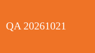

# QA FILE IMAGES
FILE-IMAGES-R03




[ordinary link](https://github.com/liyu913/test_001)

中文 English 😀

```html
<b>code-only</b>
```

| 名称 | Value |
| --- | --- |
| 测试 | 42 |

AFTER-PREVIEW-R03-V2
